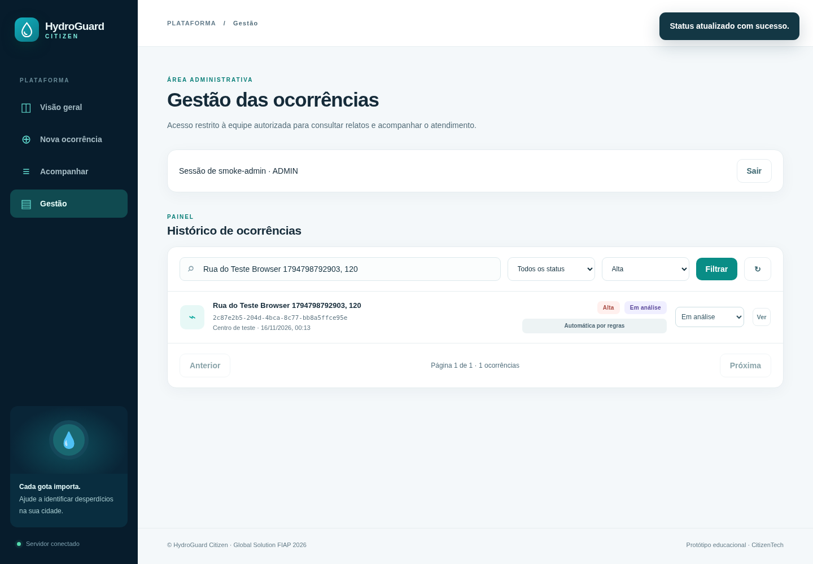
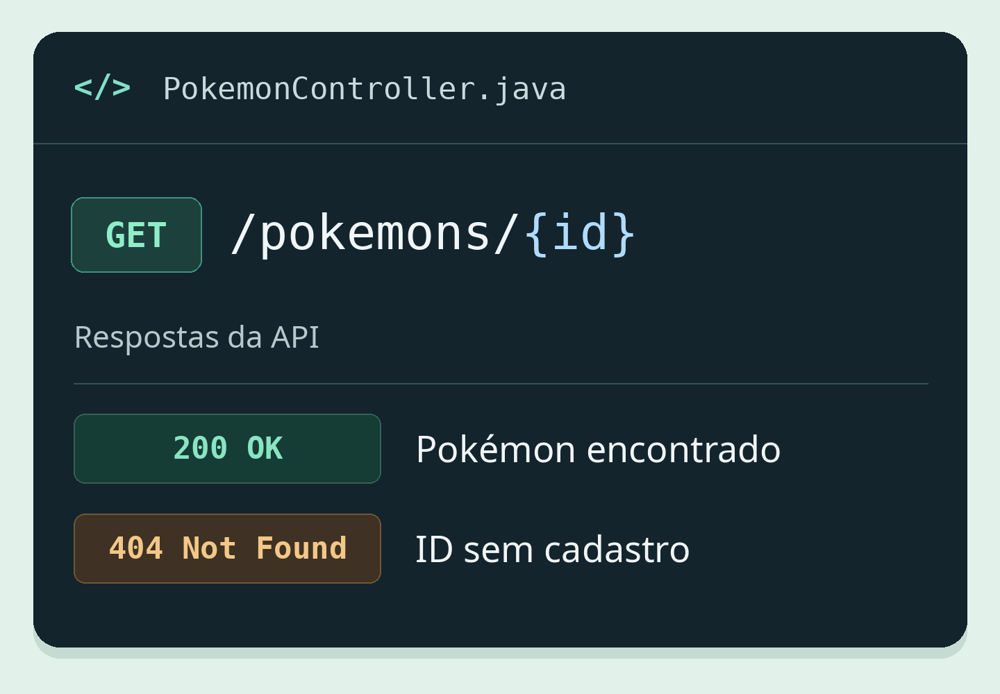

# Andre Ito

**Desenvolvimento backend com Java e Spring Boot** · Campinas, SP

Curso Análise e Desenvolvimento de Sistemas na FIAP e busco uma oportunidade como desenvolvedor backend júnior.

## Projetos em destaque

<table>
  <tr>
    <td width="50%" valign="top">
      <h3><a href="https://github.com/AndreKenji1/Global-Solution-HydroGuard#readme">HydroGuard Citizen</a></h3>
      
<code>Java 17</code> <code>Spring Boot</code> <code>PostgreSQL</code>

      
Integrei a equipe que criou a aplicação para registrar vazamentos de água e acompanhar o atendimento por protocolo.

      
      
Um teste com JUnit e MockMvc verifica que a consulta pública mostra o status e o histórico da ocorrência sem expor o endereço exato do vazamento. O GitHub Actions constrói a imagem Docker depois que os testes de integração com PostgreSQL passam.

      
<a href="https://github.com/AndreKenji1/Global-Solution-HydroGuard/blob/4b1c7fbcaf2368a3b11606504c40b9e914883b57/src/test/java/br/com/hydroguard/OcorrenciaApiTest.java#L54">Teste da consulta pública</a> · <a href="https://github.com/AndreKenji1/Global-Solution-HydroGuard/blob/main/.github/workflows/ci.yml">Integração contínua</a>

    </td>
    <td width="50%" valign="top">
      <h3><a href="https://github.com/AndreKenji1/pokedex#readme">Pokédex</a></h3>
      
<code>Java</code> <code>Spring WebFlux</code> <code>MongoDB</code>

      
Desenvolvi esta API REST para cadastrar e consultar Pokémon no MongoDB.

      
      
Usei <code>Flux</code> para listar o catálogo e <code>Mono</code> para buscar um Pokémon pelo ID. A API responde com <code>200 OK</code> quando encontra o registro e com <code>404 Not Found</code> quando o ID não existe.

      
<a href="https://github.com/AndreKenji1/pokedex/blob/0cae106415bc55abde7d626e34a8e17cc84c6857/src/main/java/com/pokedex/reactiveweb/controller/PokemonController.java#L24">Rotas da API</a> · <a href="https://github.com/AndreKenji1/pokedex/blob/0cae106415bc55abde7d626e34a8e17cc84c6857/src/main/java/com/pokedex/reactiveweb/repository/PokemonRepository.java#L6">Acesso ao MongoDB</a>

    </td>
  </tr>
</table>

## Outros projetos

<table>
  <tr>
    <td width="50%" valign="top">
      <h3>Desenvolvimento web</h3>
      
<a href="https://github.com/AndreKenji1/TrabalhoFiap"><strong>HydroGuard · Cidades ESG Inteligentes</strong></a> API em ASP.NET Core e SQL Server para monitorar consumo de água e gerar alertas de vazamento.

      
<a href="https://github.com/AndreKenji1/Fintech-FIap-atividade-cap-9"><strong>Fintech FIAP</strong></a> Interface em HTML e CSS para uma atividade acadêmica.

    </td>
    <td width="50%" valign="top">
      <h3>Processamento de imagens</h3>
      
<a href="https://github.com/AndreKenji1/segmentacao_de_imagens"><strong>Segmentação de imagens</strong></a> Experimentos de segmentação com filtros, imagens de resultado e gráficos.

    </td>
  </tr>
</table>
